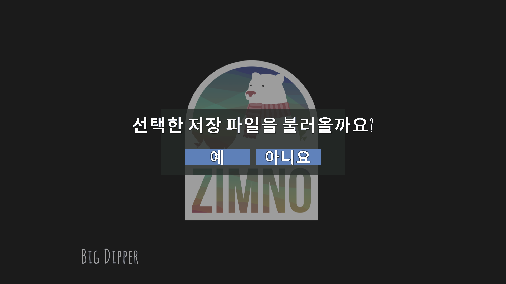

# Big Dipper 비공식 한국어 패치

Steam Windows판 **Big Dipper**용 비공식 한국어 패치입니다.

- 최신 버전: **1.2.2**
- 번역 기준: 영어 원문
- 한국어 출력 슬롯: Simplified Chinese (`Text3`)
- 번역 레코드: 1,408개
- 보존한 스크립트 명령: 579개
- 폰트: Noto Sans CJK KR Medium 기반 TextMeshPro SDF, 2,769 glyph

## 추가·변경 사항

**Big Dipper**는 앤드루, 줄리아, 니콜라스 영감님 등이 나오는 러시아어 원작 비주얼 노벨입니다(추정: 원판 씬과 인물 이름이 러시아어, 스팀 Windows 32비트판, Unity 2018.3.3f1). 원판의 언어 슬롯은 러시아어·영어·중국어(간체)로 보이며(추정), 이 패치는 **중국어(간체) 슬롯(`Text3`)을 한국어로 바꿔치기**하고 BepInEx 플러그인으로 메뉴·이름 같은 화면 글자를 실시간으로 바꿉니다. 아래 내용은 커밋(`1a71b9f`, `01f0279`), 릴리스 `v1.2.2`, 플러그인 소스(`src/BigDipperKoreanSafe.cs`), 설치 스크립트, `release/manifest.json`, `quality/` 기록을 근거로 정리했습니다.

### 번역 범위

- **번역 원문**: 영어판 대본입니다(`quality/crossreview.json`). 러시아어 원문을 직접 보지는 않았습니다.
- **본문·선택지**: 게임 대본 `Text3`(`resources.assets` 안의 텍스트 자산) 1,408개 레코드, 6,759줄 전체를 한국어로 바꿨습니다. 대본 안의 스크립트 명령 579개는 그대로 보존했습니다. 최종 대본은 `translation/Text3_Korean.txt`, 번역 맵은 `translation/translation-map.json`입니다.
- **메뉴·설정·확인창**(플러그인 내장 사전): 새 게임, 이어하기, 불러오기, 저장, 갤러리, 제작진, 설정, 종료, 뒤로, 자동, 기록, 건너뛰기, 음악, 효과음, 전체 화면, 창 모드, 언어, 메인 메뉴, 예/아니요 등. 원판의 중국어·러시아어·영어 메뉴 글자를 모두 한국어로 대응시켰습니다. 언어 선택 목록의 `简体中文`/`中文`은 「한국어」로 보입니다.
- **저장 관련 확인문**: 불러오기·덮어쓰기·삭제·메인 메뉴로 돌아가기 질문과 버튼(예: 「선택한 저장 파일을 불러올까요?」).
- **메인 메뉴 설명문**: 원판 씬에 러시아어로 박혀 있던 메뉴 설명 문장을 검수한 한국어로 바꿨습니다.
- **인물 이름**: 앤드루, 줄리아, 소녀(이름 공개 전 줄리아), 니콜라스(영감님), 어머니. 원판이 언어마다 다르게 쓰는 이름 토큰(러시아어 `Юля`, 중국어 `茱莉亚`, 영어 `Julia` 등)을 모두 한국어 이름으로 바꿉니다.
- **제작진(크레디트)**: 제작, 배급, 캐릭터 원화, CG 원화, 배경 원화, UI 디자인, 프로그래밍, 시나리오, 편집, 영어 번역, 사용 음악·효과음, 특별 감사 같은 항목 이름과 「메리 크리스마스, 새해 복 많이 받으세요!」 인사말을 바꿉니다. 사람 이름과 `freesound.org` 같은 출처는 원문 그대로입니다.
- **번역하지 않은 것**: 이미지 속 글자, 영상, 음성은 바꾸지 않았습니다(패치 파일 목록에 해당 자산이 없음, 추정). 러시아어·영어 슬롯은 그대로 남습니다.

### 편의 기능

- **한국어 자동 선택**: 게임을 켜면 플러그인이 언어 설정을 2번 슬롯(한국어로 바뀐 중국어 자리)으로 맞추고 설정을 한 번 저장합니다(`TrySetLanguage`). 따로 언어를 고를 필요가 없습니다.
- 되감기·빠른 스킵 같은 새 진행 기능은 추가하지 않았습니다.

### 단축키·조작

- 새로 넣은 단축키는 없습니다.

### 화면·글꼴

- **한글 글꼴**: `sharedassets1.assets`의 TextMeshPro 글꼴을 **Noto Sans CJK KR Medium** 기반 SDF 글꼴로 바꿨습니다. 4096×4096 아틀라스, 64pt, 여백 4, 글리프 2,769개(한글 음절 934자 + 원판 글리프 1,656개 전부 보존)입니다. 대본뿐 아니라 플러그인이 출력하는 391자까지 포함해 빠진 글자가 없음을 확인했습니다(`quality/font-report.json`, `quality/glyph-target-audit.json`). 원판의 중국어 글자도 남겨 두어, 번역이 덜 된 곳이 있어도 네모(두부)로 깨지지 않습니다(추정).
- 글꼴 라이선스는 SIL OFL 1.1이며 `licenses/OFL-NotoSansCJK.txt`에 있습니다.
- 해상도·전체화면 처리는 바꾸지 않았습니다.

### 버그 수정

- **줄리아 이름 표시**(1.2.2): 이름이 밝혀지기 전에는 「소녀」, 밝혀진 뒤에는 「줄리아」로 정확히 나오게 했습니다. 게임이 대사 화자를 정하는 `DialogueManager.set_outputChar`를 직접 후킹해 내부 키는 건드리지 않고 화면 글자만 바꿉니다.
- **메뉴·확인창 즉시 번역**(1.2.2): `ModalPanel`, `MainMenu`, `OptionsManager`, `DialogueManager`, `SaveLoadManager`, `CreditsCanvas`, `GalleryCanvas`의 실제 글자 쓰기 함수 7개와 `TMP_Text.set_text`, `TextMeshProUGUI.OnEnable`을 후킹해, 메뉴·설정·확인창이 뜨는 순간 한국어가 됩니다. 씬을 불러올 때 숨은 패널까지 한 번 훑어 바꿉니다.
- **이전 판의 위험한 후킹 제거**(1.2.2): 게임의 큰 난독화 메서드(`DialogueManager.output`, `ModalPanel.NewChoice`)를 통째로 Harmony로 고쳐 쓰던 방식이 JIT 컴파일 중 오류를 내며 초기화를 멈출 수 있어서 없앴습니다. 훅마다 실패를 따로 격리해, 하나가 실패해도 나머지는 동작합니다.
- **이전 시험판 정리**: 0.9 시험판의 옛 플러그인 폴더(`BepInEx\plugins\BigDipperKorean`)가 남아 있으면 중복 로딩을 막으려고 설치기가 지웁니다.

### 설치·제거 방식

- **설치되는 것**(`release/manifest.json`): BepInEx 5.4.23.5 로더(`winhttp.dll`, `doorstop_config.ini`, `BepInEx/core/*`), 플러그인 `BepInEx/plugins/BigDipperKoreanSafe.dll`, 한국어 대본이 들어간 `Big Dipper_Data/resources.assets`, 한글 글꼴이 들어간 `Big Dipper_Data/sharedassets1.assets`. 두 자산 파일은 차분이 아니라 통째로 교체합니다.
- **원본 확인**: `resources.assets`와 `sharedassets1.assets`의 원본·패치 SHA-256을 확인하고, 패치 파일 하나하나의 해시도 먼저 검사합니다. 게임이 실행 중이거나, 이 패치가 설치한 것이 아닌 `winhttp.dll`(다른 모드 로더)이 있으면 멈춥니다.
- **백업**: 게임 폴더 안 `_KoreanPatchBackup`에 두 자산 파일의 원본을 보관하고, 설치 표식 `.bigdipper-korean-installed`를 남깁니다. 자산은 임시 파일에 복사해 해시를 확인한 뒤 교체합니다.
- **판 올리기**: 이전 시험판이 깔려 있으면 백업한 원본으로 먼저 되돌린 뒤 새 판을 적용합니다(설치 표식과 원본 백업이 있을 때만).
- **제거**(`제거.bat`/`제거.ps1`): 원본 백업으로 두 자산을 되돌리고 해시를 확인한 뒤, 설치 표식이 있으면 로더 파일과 **`BepInEx` 폴더 전체**를 지웁니다.
- **지원 판본**: 스팀 Windows판만 확인했습니다(게임 실행 파일·`Assembly-CSharp.dll` 해시 기록, `BUILDING.md`).
- **배포 파일**: 전체 패키지는 저장소에 넣지 않고 릴리스 첨부 파일 `BigDipper_Korean_Patch_1.2.2.zip`으로만 배포합니다.

### 판(버전)별 변경 기록

- **0.9 시험판** (날짜 미상, 저장소에 없음): 설치 스크립트가 「0.9 시험판의 구형 플러그인」(`BigDipperKorean` 폴더)을 언급하므로 이전 시험판이 있었습니다. 1.0~1.2.1 판의 존재 여부와 내용은 기록에 없습니다(추정: 번역 대본 v1 → v2로 다시 만든 흔적이 `tools/build_v2_and_qa.py`에 있음).
- **1.2.2** (빌드 2026-07-21, 릴리스·커밋 `1a71b9f` 2026-07-22): 저장소 첫 공개. 전체 대본 한국어화, 메뉴·설정·확인창·줄리아 이름·한글 글꼴 수정, 위험한 대형 후킹 제거, 설치·제거 스크립트. 실제 게임 런타임 검사 22/22, 패키지·ZIP·설치본 교차 감사 72/72 통과, 오류·경고·예외·후킹 실패 0건.
- **2026-08-03** (커밋 `01f0279`): 제3자 자산 권리 고지(`ASSET_NOTICE.md`) 추가.

### 알려진 문제

- **설치 경로 기본값**: `설치.ps1`과 `제거.ps1`의 기본 게임 경로가 제작자 PC의 스팀 라이브러리 경로로 고정돼 있어서, `설치.bat`·`제거.bat`을 그냥 실행하면 대부분의 PC에서 「게임 실행 파일이 없습니다」로 멈춥니다. 아래 「설치」 절처럼 PowerShell에서 `-GameDir`로 자기 게임 경로를 직접 지정해야 합니다. 스팀 경로 자동 탐색은 없습니다.
- **제거 시 BepInEx 폴더 전체 삭제**: 이 패치 말고 다른 BepInEx 모드를 함께 쓰고 있었다면 그 모드도 함께 지워집니다.
- **영어 기준 번역**: 러시아어 원문과 대조하지 않았으므로, 영어판에서 생긴 뜻 차이가 그대로 옮겨졌을 수 있습니다(추정).
- 런타임 검사는 메뉴·불러오기 확인창·줄리아 이름 공개 전후 장면 위주이며, 모든 분기·엔딩을 끝까지 확인했다는 기록은 없습니다.
- `tools/`의 빌드 도구에는 작업 PC 경로가 상수로 들어 있어, 다른 PC에서 쓰려면 먼저 고쳐야 합니다(`BUILDING.md`).

## 설치

1. Releases에서 `BigDipper_Korean_Patch_1.2.2.zip`을 받습니다.
2. 압축을 풉니다.
3. 게임을 완전히 종료한 상태에서 `설치.bat`을 실행합니다.
4. Steam에서 게임을 실행합니다.

설치 스크립트의 기본 게임 경로는 제작자 PC 기준이라 대부분의 PC와 맞지 않습니다. `설치.bat`이 「게임 실행 파일이 없습니다」라며 멈추면, PowerShell에서 자기 게임 폴더(`Big Dipper.exe`가 있는 `WIN` 폴더)를 직접 지정해 실행합니다.

```powershell
powershell.exe -NoProfile -ExecutionPolicy Bypass -File .\설치.ps1 -GameDir '<스팀 라이브러리>\steamapps\common\Big Dipper\WIN'
```

제거할 때는 게임을 종료한 뒤 `제거.bat`을 실행합니다. 경로가 다르면 같은 방식으로 `.\제거.ps1 -GameDir '...'`을 실행합니다.

## 검증

- 실제 게임 런타임 검사: **22/22 통과**
- 최종 패키지·ZIP·라이브 설치 교차 감사: **72/72 통과**
- 런타임 오류·경고·예외·후킹 실패: **0건**
- 번역 QA 오류·경고: **0건**




## 저장소 구성

- `src/`: 런타임 한국어화 플러그인 소스
- `bin/`: 검증된 1.2.2 플러그인 DLL
- `translation/`: 최종 한국어 대본과 번역 맵
- `installer/`: 설치·복원 스크립트
- `tools/`: 폰트, 패키지, 감사 도구
- `quality/`: 번역·폰트·런타임 검증 자료
- `release/`: 릴리스 manifest와 SHA-256

전체 설치 패키지는 저장소에 직접 커밋하지 않고 GitHub Release 첨부 파일로 제공합니다.

## 릴리스 해시

`BigDipper_Korean_Patch_1.2.2.zip`

```text
00f0f456b55e587cd4fda29eebf32d5420077c2f0e6f0b7107baa898d7544da8
```

폰트 라이선스는 `licenses/OFL-NotoSansCJK.txt`를 참조하십시오.
